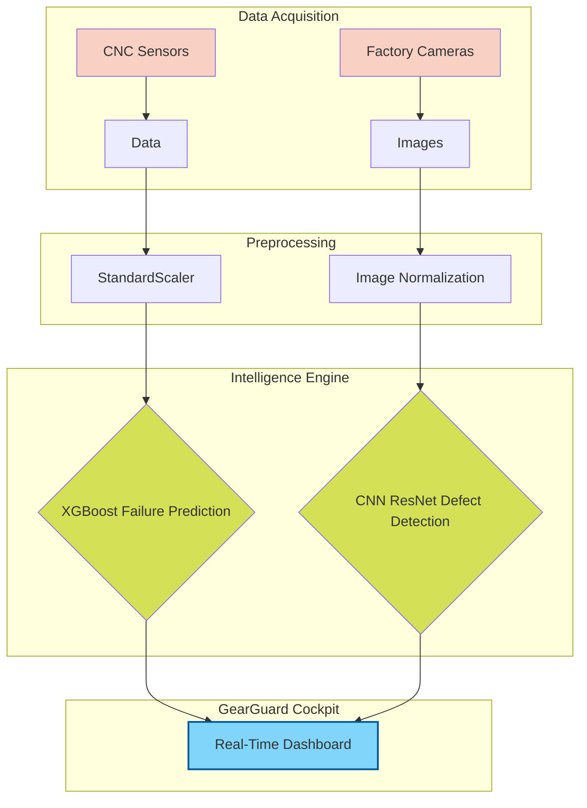

# GearGuard: Autonomous Sensor Analytics and Industrial failure Prevention

## Project Abstract

### 1. Objectives
Unplanned machine downtime is a critical bottleneck in modern manufacturing, leading to massive financial losses and disrupted supply chains. The primary objectives of this project are:
* To develop an autonomous predictive maintenance system capable of forecasting machine failures before they occur.
* To transition maintenance strategies from purely reactive (run-to-failure) to highly proactive.
* To engineer a centralized "Cockpit" dashboard that integrates real-time sensor telemetry and Deep Learning-based visual inspection for holistic factory monitoring.

### 2. Machine Learning & Deep Learning Methods Used
This project utilizes a hybrid AI approach to handle both numerical telemetry and image data:
* **Gradient Boosting (XGBoost) & Random Forest:** Used for the primary binary classification task (predicting imminent machine failure). These tree-based ensemble methods are highly effective at capturing non-linear relationships in sensor data.
* **Logistic Regression:** Implemented as a baseline statistical model to benchmark the performance of the advanced algorithms.
* **Convolutional Neural Networks (CNNs):** Utilizing Deep Learning architectures (via PyTorch/Torchvision) for the Visual Inspection module to automatically detect structural defects on the factory line.

### 3. Corresponding Datasets Used
* **Telemetry Data (Created / Synthetic):** We generated a robust synthetic Predictive Maintenance dataset containing 10,000 samples. This dataset mirrors the statistical properties of the public **AI4I 2020 Predictive Maintenance Dataset** and includes critical features: Air Temperature [K], Process Temperature [K], Rotational Speed [RPM], Torque [Nm], and Tool Wear [min].
* **Visual Inspection Data (Public):** We incorporate public industrial defect datasets (such as the NEU Surface Defect Database) to train and evaluate the deep learning computer vision models.

### 4. Methodology Workflow Diagram



### 5. References
1. Stephan Matzka, "Explainable Artificial Intelligence for Predictive Maintenance Applications," Third International Conference on Artificial Intelligence for Industries (AI4I 2020), 2020.
2. Chen, T., & Guestrin, C. (2016). "XGBoost: A Scalable Tree Boosting System." Proceedings of the 22nd ACM SIGKDD International Conference.
3. He, K., et al. (2016). "Deep Residual Learning for Image Recognition." CVPR.

---

## Developer Setup Guide

### 1. Backend (FastAPI)
```bash
# Activate the virtual environment
backend\.venv\Scripts\Activate.ps1

# Install requirements (if not already installed)
pip install -r backend/requirements.txt

# Start the Python Server
python -m backend.app.main
```

### 2. Frontend (React Dashboard)
```bash
cd frontend
npm install
npm run dev
```

### 3. Machine Learning (Jupyter)
To view the Exploratory Data Analysis (EDA) and Model Training pipeline:
```bash
# Ensure virtual environment is active
jupyter lab
# Open ml/notebooks/01_EDA_and_Modeling.ipynb
```
